# Auth-Service Class Diagram

อิงจากโค้ดจริงใน `backend/services/auth-service` (branch `ceo`, 2026-10-19)

## วิธีอ่าน

- โค้ดเป็น JavaScript แบบ CommonJS ไม่มี `class` จริง: แต่ละ **ไฟล์ module = 1 class** ในแผนภาพ
  และ **ฟังก์ชันใน module = method**
- `+` คือฟังก์ชันที่ `module.exports` ออกไป (public) · `-` คือฟังก์ชัน/ค่าคงที่ภายในไฟล์ (private)
- รูปแบบ method: `ชื่อ(Type param, ...) ReturnType` ตรงกับ `ชื่อ(param) :: ReturnType`
- ฟังก์ชันที่รับ object แบบ destructure เช่น `createReport({ reporterId, targetId })`
  เขียนเป็นพารามิเตอร์แยกตาม field ที่โค้ดอ่านจริง
- Controller ทุกตัวมี signature แบบ Express: `(Request req, Response res, NextFunction next) Promise~void~`
  ย่อเป็น `(req, res, next)`
- `Promise~T~` = `Promise<T>` · `Tx` = Prisma transaction client · `PrismaClient` = `src/models/prismaClient.js`
- Entity มาจาก `prisma/schema.prisma` · `Type?` = nullable

---

## 1. Domain Entities (Prisma models)

```mermaid
classDiagram
  direction LR

  class KycStatus {
    <<enumeration>>
    NONE
    PENDING
    VERIFIED
    REJECTED
    EXPIRED
    INACTIVE_EXPIRED
  }

  class ReportStatus {
    <<enumeration>>
    OPEN
    REVIEWED
    ACTIONED
    DISMISSED
  }

  class User {
    <<users>>
    -String id
    -String email
    -String passwordHash
    -String firstName
    -String lastName
    -String? phone
    -String role
    -String status
    -DateTime createdAt
    -DateTime updatedAt
  }

  class UserAddress {
    <<user_addresses>>
    -String id
    -String userId
    -String recipientName
    -String phone
    -String addressLine
    -String subdistrict
    -String district
    -String province
    -String postalCode
    -Boolean isDefault
    -DateTime createdAt
    -DateTime updatedAt
  }

  class BuyerProfile {
    <<buyer_profiles>>
    -String userId
    -String? favoriteCategory
    -String? stylePreference
    -String? sizePreference
    -String? brandPreference
    -DateTime updatedAt
  }

  class BuyerPreference {
    <<buyer_preferences>>
    -String userId
    -String kind
    -String category
    -String value
  }

  class SellerProfile {
    <<seller_profiles>>
    -String userId
    -String shopName
    -String? idCardNumber
    -DateTime? idCardExpiry
    -String? address
    -String? bankAccount
    -KycStatus kycStatus
    -String? kycStorageKey
    -DateTime? verifiedAt
    -DateTime? lastActiveAt
  }

  class AutoMessage {
    <<auto_messages>>
    -String id
    -String userId
    -String messageText
    -Boolean isActive
  }

  class LoginLog {
    <<login_logs>>
    -String id
    -String userId
    -String? sessionId
    -DateTime loginAt
    -DateTime? logoutAt
    -String? ipAddress
    -String? userAgent
  }

  class BuyerActivityLog {
    <<buyer_activity_logs>>
    -String id
    -String buyerId
    -String action
    -String source
    -String? targetType
    -String? targetId
    -Json? metadata
    -String? requestId
    -String? ipAddress
    -String? userAgent
    -DateTime occurredAt
    -DateTime createdAt
  }

  class RefreshToken {
    <<refresh_tokens>>
    -String id
    -String userId
    -String token
    -DateTime expiresAt
    -DateTime? revokedAt
    -DateTime createdAt
  }

  class Report {
    <<reports>>
    -String id
    -String reporterId
    -String? targetId
    -String? productId
    -String reason
    -ReportStatus status
    -DateTime reportedAt
    -DateTime? reviewedAt
    -String? reviewedBy
    -String? actionTaken
  }

  class AdminAudit {
    <<admin_audits>>
    -String id
    -String actorId
    -String action
    -String targetId
    -String reason
    -String? requestId
    -DateTime createdAt
  }

  class BulkActionRun {
    <<bulk_action_runs>>
    -String id
    -String idempotencyKey
    -String actorId
    -String action
    -String reason
    -String[] requestedIds
    -Json results
    -DateTime createdAt
  }

  class RoleDefinition {
    <<role>>
    -String id
    -String code
  }

  class UserRole {
    <<user_roles>>
    -String id
    -String userId
    -String role
    -DateTime createdAt
  }

  class KycApplication {
    <<kyc_applications>>
    -String id
    -String userId
    -String storageKey
    -String fileType
    -KycStatus status
    -String? reason
    -Int version
    -DateTime submittedAt
    -DateTime? decidedAt
    -String? decidedBy
  }

  class ExecutiveAuditLog {
    <<executive_audit_logs>>
    -String id
    -String actorId
    -String? actorEmail
    -String? actorRole
    -String action
    -String category
    -String? targetType
    -String? targetId
    -String description
    -Json? metadata
    -String? ipAddress
    -String? userAgent
    -DateTime createdAt
  }

  class ShopChangeRequest {
    <<shop_change_requests>>
    -String id
    -String sellerId
    -String comment
    -String status
    -String? adminNote
    -String? reviewedBy
    -DateTime? reviewedAt
    -DateTime createdAt
  }

  class ShopChangeRequestItem {
    <<shop_change_request_items>>
    -String id
    -String requestId
    -String fieldName
    -String? oldValue
    -String newValue
    -DateTime createdAt
  }

  User "1" *-- "0..*" UserAddress : addresses
  User "1" -- "0..1" BuyerProfile : buyerProfile
  User "1" -- "0..1" SellerProfile : sellerProfile
  BuyerProfile "1" *-- "0..*" BuyerPreference : preferences
  SellerProfile "1" *-- "0..*" AutoMessage : autoMessages
  User "1" -- "0..*" LoginLog : loginLogs
  User "1" -- "0..*" BuyerActivityLog : buyerActivityLogs
  User "1" -- "0..*" RefreshToken : refreshTokens
  User "1" -- "0..*" Report : reporter
  User "1" -- "0..*" UserRole : roles
  RoleDefinition "1" -- "0..*" UserRole : role_code
  User "1" -- "0..*" KycApplication : kycApplications
  User "1" -- "0..*" ShopChangeRequest : seller
  ShopChangeRequest "1" *-- "0..*" ShopChangeRequestItem : items
  User "1" -- "0..*" AdminAudit : actor
  User "1" -- "0..*" BulkActionRun : actor
  User "1" -- "0..*" ExecutiveAuditLog : actor
  SellerProfile ..> KycStatus
  KycApplication ..> KycStatus
  Report ..> ReportStatus
  LoginLog ..> RefreshToken : sessionId (logical, no FK)
```

`*--` คือ composition ที่ schema ลบตามแบบ `onDelete: Cascade` ส่วน `--` คือ relation ปกติ

---

## 2. Core Auth: Login, Token, Session, Shop Change

```mermaid
classDiagram
  direction TB

  class Server {
    <<src/server.js>>
    -String PORT
    +requireEnv(String[] names) void
    +listen() void
  }

  class App {
    <<src/app.js>>
    +express app
    +POST_internal_sessions_validate(req, res, next) Promise~void~
    +GET_internal_users_id(req, res, next) Promise~void~
    +GET_health(req, res) void
  }

  class AuthController {
    <<controllers/authController.js>>
    +register(req, res, next) Promise~void~
    +login(req, res, next) Promise~void~
    +refresh(req, res, next) Promise~void~
    +logout(req, res, next) Promise~void~
    +me(req, res, next) Promise~void~
    +updateMe(req, res, next) Promise~void~
    +publicProfile(req, res, next) Promise~void~
    +getMyShopProfile(req, res, next) Promise~void~
    +submitShopChangeRequest(req, res, next) Promise~void~
    +getMyChangeRequests(req, res, next) Promise~void~
    +getPendingChangeRequests(req, res, next) Promise~void~
    +decideChangeRequest(req, res, next) Promise~void~
  }

  class AuthService {
    <<services/authService.js>>
    -Number REFRESH_TTL_MS
    -Map ROLE_ID_BY_CODE
    -Number MAX_DISPLAY_NAME_IDS
    -ensureRoleCatalogEntry(PrismaClient db, String role) Promise~void~
    -toPublicUser(User user) PublicUser
    -ensureRoleRowsMigrated(String userId, PrismaClient db) Promise~String[]~
    -buildAccessTokenClaims(User user, PrismaClient db) Promise~AccessTokenClaims~
    -issueTokenPair(User user, Object loginContext) Promise~TokenPair~
    +register(String email, String password, String firstName, String lastName, String phone) Promise~AuthResult~
    +login(String email, String password, String ipAddress, String userAgent) Promise~AuthResult~
    +refresh(String refreshToken) Promise~Object~
    +logout(String refreshToken) Promise~void~
    +getById(String userId) Promise~PublicUser~
    +updateProfile(String userId, String firstName, String lastName, String phone) Promise~PublicUser~
    +getDisplayNames(String[] userIds) Promise~Object[]~
    +getPublicSellerProfile(String userId) Promise~Object~
    +getMyShopProfile(String userId) Promise~Object~
    +submitShopChangeRequest(String sellerId, Object payload) Promise~Object~
    +listMyChangeRequests(String sellerId) Promise~Object~
    +listPendingChangeRequests() Promise~Object~
    +decideChangeRequest(String adminId, String requestId, Object payload) Promise~Object~
    +getUserRoles(String userId, PrismaClient db) Promise~String[]~
    +assignRole(String userId, String role, PrismaClient db) Promise~String[]~
    +removeRole(String userId, String role) Promise~String[]~
  }

  class SessionService {
    <<services/sessionService.js>>
    +assertActive(User user) void
    +revokedSession() AppError
    +validateAccessSession(Object payload) Promise~Object~
    +lockUser(Tx tx, String userId) Promise~User~
  }

  class ShopChangeRequestService {
    <<services/shopChangeRequestService.js>>
    +String[] SHOP_CHANGE_FIELDS
    -Map FIELD_BY_STORED_NAME
    -cleanComment(String comment) String
    -buildChangeItems(Object input, SellerProfile profile) Object[]
    +serializeRequest(ShopChangeRequest request) Object
    +createShopChangeRequestService(PrismaClient prismaClient) ShopChangeRequestService
    +submit(String sellerId, Object payload) Promise~Object~
    +listMine(String sellerId) Promise~Object~
    +listPending() Promise~Object~
    +decide(String adminId, String requestId, String decision, String adminNote) Promise~Object~
  }

  class RoleCatalog {
    <<prisma/roleCatalog.js>>
    +String[][] ROLE_CATALOG
    +seedRoleCatalog(PrismaClient prisma) Promise~void~
  }

  class PrismaClientModule {
    <<models/prismaClient.js>>
    +PrismaClient prisma
  }

  class PublicUser {
    <<DTO>>
    +String id
    +String email
    +String firstName
    +String lastName
    +String phone
    +String role
  }

  class AccessTokenClaims {
    <<DTO JWT payload>>
    +String sub
    +String sid
    +String role
    +String[] roles
    +String[] permissions
    +Boolean kycVerified
    +String kycStatus
    +String displayName
    +String accountStatus
    +String[] commerceRestrictions
  }

  class TokenPair {
    <<DTO>>
    +String accessToken
    +String refreshToken
  }

  class AuthResult {
    <<DTO>>
    +PublicUser user
    +String accessToken
    +String refreshToken
  }

  class SharedAuthMiddleware {
    <<@reloop/shared authMiddleware.js>>
    +requireAuth(req, res, next) Promise~void~
    +requireRole(String roles) Middleware
    +requirePermission(String permission) Middleware
    +requireCustomerAccount(req, res, next) void
    +requireInternalToken(req, res, next) void
  }

  class SharedJwt {
    <<@reloop/shared jwt.js>>
    +signAccessToken(Object payload) String
    +signRefreshToken(Object payload) String
    +verifyAccessToken(String token) Object
    +verifyRefreshToken(String token) Object
  }

  class SharedPermissions {
    <<@reloop/shared permissions.js>>
    +Object ROLE_PERMISSIONS
    +String[] ALL_ROLES
    +String[] CUSTOMER_ROLES
    +String[] STAFF_ROLES
    +isValidRoleCombination(String[] roles) Boolean
    +isCustomerAccount(String[] roles) Boolean
    +permissionsForRoles(String[] roles) String[]
    +hasPermission(String[] roles, String permission) Boolean
  }

  class SharedCommerceRestrictions {
    <<@reloop/shared commerceRestrictions.js>>
    +Object RESTRICTION_STATUS
    +Object CAPABILITY
    +restrictionsForStatus(String status) String[]
    +isRestrictedStatus(String status) Boolean
    +requireCommerceCapability(String capability) Middleware
  }

  Server --> App : require
  App --> AuthController : authRoutes
  App --> SessionService : app.locals.validateAccessSession
  App --> AuthService : getUserRoles
  AuthController --> AuthService
  AuthService --> SessionService
  AuthService --> ShopChangeRequestService
  AuthService --> RoleCatalog
  AuthService --> SharedJwt
  AuthService --> SharedPermissions
  AuthService --> SharedCommerceRestrictions
  AuthService --> PrismaClientModule
  SessionService --> PrismaClientModule
  ShopChangeRequestService --> PrismaClientModule
  AuthService ..> PublicUser
  AuthService ..> AccessTokenClaims
  AuthService ..> TokenPair
  AuthService ..> AuthResult
  AuthResult *-- PublicUser
  SharedAuthMiddleware --> SharedJwt
  SharedAuthMiddleware --> SharedPermissions
```

---

## 3. Admin / Trust & Safety: KYC, Report, Restriction, Bulk, Moderation, Audit, Jobs

```mermaid
classDiagram
  direction TB

  class KycController {
    <<features/kyc/kycController.js>>
    +Middleware[] submit
    +mine(req, res, next) Promise~void~
    +viewDocument(req, res, next) Promise~void~
  }

  class KycService {
    <<features/kyc/kycService.js>>
    +submitKyc(String userId, String shopName, String idCardNumber, String idCardExpiry, String address, String bankAccount, String verifyMethod, File file) Promise~Object~
    +getMine(String userId) Promise~Object~
    +viewDocument(String applicationId, String userId, String[] permissions, String requestId) Promise~Object~
  }

  class KycStorage {
    <<features/kyc/kycStorage.js>>
    +String STORAGE_DIR
    +Multer upload
    -RegExp ALLOWED_MIME
    +absolutePath(String storageKey) String
    +persistDocument(File file) Promise~String~
    +removeDocument(String storageKey) Promise~void~
    +assertDocumentExists(String storageKey) Promise~String~
  }

  class AdminKycService {
    <<features/adminKyc/adminKycService.js>>
    -String[] ALLOWED_DECISIONS
    +listQueue(Int page, Int limit, String status) Promise~Object~
    +decideKyc(String applicationId, String decision, String reason, Int version, String adminId, String requestId) Promise~Object~
  }

  class ReportService {
    <<features/reports/reportService.js>>
    -String[] VALID_DECISIONS
    -String[] USER_ACTIONS
    -toPublicUser(User user) Object
    -reportSearchWhere(String search) Object
    -actionProductReport(Report report, String actorId, String reason, String requestId, String idempotencyKey) Promise~Report~
    -suspendUserInTx(Tx tx, String targetId, String actorId, String reason, String requestId) Promise~Object~
    -warnUserInTx(Tx tx, String targetId, String actorId, String reason, String requestId) Promise~Object~
    +recordAdminAction(String actorId, String action, String targetId, String reason, String requestId, Tx tx) Promise~AdminAudit~
    +createReport(String reporterId, String targetId, String productId, String reason) Promise~Report~
    +listReports(Int page, Int limit, String status, String search) Promise~Object~
    +getReportDetail(String reportId) Promise~Object~
    +reviewReport(String reportId, String adminId, String staffId, String requestId) Promise~Report~
    +actionReport(String reportId, String adminId, String staffId, String decision, String reason, String requestId, String idempotencyKey) Promise~Report~
    +suspendUser(String targetId, String adminId, String staffId, String reason, String requestId) Promise~Object~
    +warnUser(String targetId, String adminId, String staffId, String reason, String requestId) Promise~Object~
    +restoreUser(String targetId, String adminId, String staffId, String reason, String requestId) Promise~Object~
    +getUserSafetySummary(String targetId) Promise~Object~
    +listUserHistory(String targetId, String kind, Int page, Int limit) Promise~Object~
    +getUserDetail(String identifier) Promise~Object~
  }

  class RestrictionService {
    <<features/commerceRestrictions/restrictionService.js>>
    -Object RESTRICT_ACTION
    -normalizeScope(String scope) String
    -requireReason(String reason) String
    -assertScopeMatchesRoles(String scope, String[] roles) void
    -responseFor(User user, Object event, Boolean includeInternal) Object
    +restrict(String targetId, String actorId, String scope, String reason, String requestId) Promise~Object~
    +revoke(String targetId, String actorId, String scope, String reason, String requestId) Promise~Object~
    +getForUser(String userId) Promise~Object~
  }

  class BulkActionService {
    <<features/bulkActions/bulkActionService.js>>
    +Int MAX_BATCH_SIZE
    -assertSameRequest(BulkActionRun run) void
    +executeBatch(String action, String[] ids, String reason, Boolean dryRun, String idempotencyKey, String adminId, String staffId, String requestId, String[] permissions) Promise~Object~
  }

  class ActionRegistry {
    <<features/bulkActions/actionRegistry.js>>
    +Object registry
    +getAction(String name) BulkActionHandler
  }

  class BulkActionHandler {
    <<interface>>
    +String permission
    +preview(String id, String adminId, String staffId) Promise~Object~
    +execute(String id, String reason, String adminId, String staffId, String requestId) Promise~Object~
  }

  class SUSPEND_USER {
    <<handler>>
    +String permission
  }
  class WARN_USER {
    <<handler>>
    +String permission
  }
  class RESTORE_USER {
    <<handler>>
    +String permission
  }

  class ProductModerationService {
    <<features/productModeration/productModerationService.js>>
    -executeModeration(String action, String productId, String actorId, String reason, String idempotencyKey, String requestId) Promise~Object~
    +removeProduct(String productId, String adminId, String staffId, String reason, String idempotencyKey, String requestId) Promise~Object~
    +restoreProduct(String productId, String adminId, String staffId, String reason, String idempotencyKey, String requestId) Promise~Object~
  }

  class ProductModerationClient {
    <<services/productModerationClient.js>>
    -String PRODUCT_SERVICE_URL
    -String INTERNAL_TOKEN
    -moderationRequestSignal() AbortSignal
    +getProduct(String productId) Promise~Object~
    +removeProduct(String productId, String reason, String idempotencyKey) Promise~Object~
    +restoreProduct(String productId, String reason, String idempotencyKey) Promise~Object~
  }

  class AuditQuery {
    <<features/audit/auditQuery.js>>
    -parseDate(String value, String label) Date
    -targetType(String action) String
    +normalize(AdminAudit item) Object
    +queryAudit(Int page, Int limit, String actorId, String action, String actionPrefix, String targetId, String requestId, String from, String to) Promise~Object~
  }

  class KycExpiryJob {
    <<jobs/kycExpiryJob.js>>
    -Int RUN_INTERVAL_MS
    -Int START_DELAY_MS
    +runExpiryCheck() Promise~void~
    +start() void
  }

  class SellerInactivityJob {
    <<jobs/sellerInactivityJob.js>>
    -Int RUN_INTERVAL_MS
    -Int START_DELAY_MS
    -Int INACTIVITY_THRESHOLD_DAYS
    +runInactivityCheck() Promise~void~
    +start() void
  }

  class SellerActivityService {
    <<features/sellerActivity/sellerActivityService.js>>
    +recordActivity(String sellerId) Promise~void~
  }

  KycController --> KycService
  KycController --> KycStorage : upload.single
  KycService --> KycStorage
  KycService --> AuthService : assignRole
  KycService --> SessionService : lockUser
  KycService ..> KycApplication
  KycService ..> SellerProfile
  AdminKycService ..> KycApplication
  AdminKycService ..> AdminAudit
  ReportService --> ProductModerationClient
  ReportService --> SessionService : lockUser
  ReportService ..> Report
  ReportService ..> AdminAudit
  RestrictionService --> SessionService : lockUser
  RestrictionService --> AuthService : getUserRoles
  BulkActionService --> ActionRegistry
  BulkActionService ..> BulkActionRun
  ActionRegistry --> BulkActionHandler
  BulkActionHandler <|.. SUSPEND_USER
  BulkActionHandler <|.. WARN_USER
  BulkActionHandler <|.. RESTORE_USER
  SUSPEND_USER --> ReportService : suspendUser
  WARN_USER --> ReportService : warnUser
  RESTORE_USER --> ReportService : restoreUser
  ProductModerationService --> ProductModerationClient
  ProductModerationService --> ReportService : recordAdminAction
  AuditQuery ..> AdminAudit
  KycExpiryJob ..> SellerProfile
  SellerInactivityJob ..> SellerProfile
  SellerActivityService ..> SellerProfile
```

> Router ฝั่งนี้ (`adminKycRoutes`, `reportRoutes`, `restrictionRoutes`, `bulkActionRoutes`,
> `productModerationRoutes`, `auditRoutes`) เขียน handler แบบ inline ใน router จึงไม่มี controller แยก
> แผนภาพนี้จึงแสดงเฉพาะชั้น service

---

## 4. Executive, Marketing, Profile, Buyer Audit, Internal

```mermaid
classDiagram
  direction TB

  class MetricsController {
    <<features/metrics/metricsController.js>>
    -String[] REPORT_STATUSES
    -String[] VALID_SORT_OPTIONS
    -String[] VALID_REASON_CATEGORIES
    +getMetrics(req, res, next) Promise~void~
    +getMetricsSeries(req, res, next) Promise~void~
    +getReports(req, res, next) Promise~void~
  }

  class UserMetrics {
    <<features/metrics/userMetrics.js>>
    -Object USER_ID_COLUMNS
    -customerAccount(String column) Sql
    +getUserMetrics(Date from, Date to) Promise~Object~
    +getUserMetricsSeries(Date from, Date to, String granularity, String timezone) Promise~Object[]~
  }

  class ExecutiveReports {
    <<features/metrics/executiveReports.js>>
    +String[] OPEN_STATUSES
    +Object CATEGORY_KEYWORDS
    +Int DEFAULT_ANOMALY_THRESHOLD
    +categorizeReason(String reason) String
    -toItem(Report report, Map targetMap, Object actionMap) Object
    -enrichReportActions(Report[] reports) Promise~Object~
    +enrichTargets(String[] allTargetIds) Promise~Map~
    +getReportOverview(Object range, String status, Int limit, String sortBy, String reasonCategory, String targetId, String search, Int page) Promise~Object~
  }

  class ReportSearch {
    <<features/metrics/reportSearch.js>>
    -reportPredicate(Object filters, Object definitions) Sql
    +findReportPage(PrismaClient prisma, Object filters, Object definitions) Promise~Object~
  }

  class ReportConfig {
    <<features/metrics/reportConfig.js>>
    -positiveIntegerEnv(String name, Int fallback) Int
    +Int DEFAULT_REPORT_LIMIT
    +Int MAX_REPORT_LIMIT
    +Int ANOMALY_THRESHOLD
  }

  class ExecutiveAuditController {
    <<features/executiveAudit/executiveAuditController.js>>
    +extractActor(Request req) Object
    +createAuditLog(req, res, next) Promise~void~
    +getAuditLogs(req, res, next) Promise~void~
  }

  class ExecutiveAuditService {
    <<features/executiveAudit/executiveAuditService.js>>
    +Int MAX_AUDIT_LIMIT
    +Int DEFAULT_AUDIT_LIMIT
    +Object AUDIT_CATEGORIES
    +recordExecutiveAudit(String actorId, String actorRole, String action, String category, String targetType, String targetId, String description, Object metadata, String ipAddress, String userAgent) Promise~ExecutiveAuditLog~
    -buildDateRangeFilter(String from, String to) Object
    +queryExecutiveAudit(Int page, Int limit, String actorId, String action, String category, String targetType, String from, String to) Promise~Object~
  }

  class ExecutiveAuditPolicy {
    <<features/executiveAudit/executiveAuditPolicy.js>>
    +Object ACTIONS
    -String[] MONTH_NAMES
    -RegExp TARGET_ID
    -integer(Int min, Int max) Function
    -oneOf(String allowed) Function
    +buildAuditEntry(Object body) Object
  }

  class MarketingMetricsController {
    <<features/metrics/marketingMetricsController.js>>
    +getUserAnalytics(req, res, next) Promise~void~
  }

  class ActivityMetrics {
    <<features/metrics/activityMetrics.js>>
    +String DEFAULT_TIMEZONE
    +String[] SUPPORTED_TIMEZONES
    +Int MAX_HOURLY_DAYS
    -Int BANGKOK_OFFSET_MS
    -Int MAX_HOURLY_HOURS
    +formatBangkokIsoHour(Date date) String
    +formatBangkokIsoBoundary(Date val) String
    -parseDateInput(String val) Date
    +parseAndValidateRange(Object query) Object
    +buildHourlyPeriods(Date from, Date to) Date[]
    +findPeakHour(Object[] hourlyUsage) Object
    +serializeUserAnalytics(Object range, Int activeUsers, Int newUsers, Object peakHour, Object[] hourlyUsage) Object
    +getUserUsageAnalytics(Object query, PrismaClient prisma) Promise~Object~
  }

  class SharedExecutiveMetrics {
    <<@reloop/shared executiveMetrics.js>>
    +String METRIC_DEFINITION_VERSION
    +String DEFAULT_METRIC_TIMEZONE
    +resolveMetricRange(Object query) Object
    +metricMeta(Date from, Date to, String timezone) Object
    +buildSeriesPeriods(Date from, Date to, String granularity, String timezone, String[] granularities) Date[]
    +fillSeriesGaps(Date[] periods, Object[] rows, Object zeroRow) Object[]
  }

  class BuyerAuditController {
    <<features/buyerAudit/buyerAuditController.js>>
    -requestContext(Request req) Object
    +recordOwnActivity(req, res, next) Promise~void~
    +recordInternalActivity(req, res, next) Promise~void~
    +listOwnActivity(req, res, next) Promise~void~
    +listBuyerActivity(req, res, next) Promise~void~
    +listOwnLoginHistory(req, res, next) Promise~void~
    +listBuyerLoginHistory(req, res, next) Promise~void~
  }

  class BuyerAuditService {
    <<features/buyerAudit/buyerAuditService.js>>
    +String[] BUYER_ACTIVITY_ACTIONS
    -Set SELF_REPORTED_ACTIONS
    -Int MAX_METADATA_BYTES
    -cleanOptionalText(String value, String field, Int maxLength) String
    -cleanMetadata(Object metadata) Object
    -cleanOccurredAt(String value) Date
    -assertBuyer(String buyerId) Promise~void~
    -validateAction(String action, Set allowedActions) String
    -createActivity(String buyerId, String action, String source, String targetType, String targetId, Object metadata, String requestId, String ipAddress, String userAgent, String occurredAt) Promise~Object~
    -parseDateFilter(String value, String field) Date
    +recordOwnActivity(String buyerId, Object payload, Object context) Promise~Object~
    +recordInternalActivity(Object payload, Object context) Promise~Object~
    +listActivity(String buyerId, Int page, Int limit, String action, String from, String to) Promise~Object~
    +listLoginHistory(String buyerId, Int page, Int limit) Promise~Object~
  }

  class StyleProfileController {
    <<features/styleProfile/styleProfileController.js>>
    +get(req, res, next) Promise~void~
    +update(req, res, next) Promise~void~
  }

  class StyleProfileService {
    <<features/styleProfile/styleProfileService.js>>
    -Object KINDS
    -Object INCLUDE
    -emptyProfile() Object
    -profileView(BuyerProfile row) Object
    -text(String value) String
    -selections(String[] values) String[]
    -normalizeInput(Object input) Object
    -preferenceRows(String userId, Object data) Object[]
    +createStyleProfileService(PrismaClient db) StyleProfileService
    +get(String userId) Promise~Object~
    +update(String userId, Object input) Promise~Object~
  }

  class ProfileAddressController {
    <<features/profileAddresses/profileAddressController.js>>
    +list(req, res, next) Promise~void~
    +create(req, res, next) Promise~void~
    +update(req, res, next) Promise~void~
    +setDefault(req, res, next) Promise~void~
    +remove(req, res, next) Promise~void~
  }

  class ProfileAddressService {
    <<features/profileAddresses/profileAddressService.js>>
    -String[] REQUIRED_FIELDS
    -normalizeAddressInput(Object input, Boolean partial) Object
    +createProfileAddressService(PrismaClient prismaClient) ProfileAddressService
    +list(String userId) Promise~UserAddress[]~
    +create(String userId, Object input) Promise~UserAddress~
    +update(String userId, String addressId, Object input) Promise~UserAddress~
    +setDefault(String userId, String addressId) Promise~UserAddress~
    +remove(String userId, String addressId) Promise~void~
  }

  class InternalController {
    <<features/internal/internalController.js>>
    +displayNames(req, res, next) Promise~void~
    +eligibleStaff(req, res, next) Promise~void~
  }

  MetricsController --> UserMetrics
  MetricsController --> ExecutiveReports
  MetricsController --> ReportConfig
  MetricsController --> SharedExecutiveMetrics
  ExecutiveReports --> ReportSearch
  ExecutiveReports --> ReportConfig
  ExecutiveReports ..> Report
  ExecutiveReports ..> AdminAudit
  UserMetrics ..> LoginLog
  UserMetrics ..> User
  ExecutiveAuditController --> ExecutiveAuditPolicy
  ExecutiveAuditController --> ExecutiveAuditService
  ExecutiveAuditService ..> ExecutiveAuditLog
  MarketingMetricsController --> ActivityMetrics
  ActivityMetrics ..> LoginLog
  ActivityMetrics ..> BuyerActivityLog
  BuyerAuditController --> BuyerAuditService
  BuyerAuditService ..> BuyerActivityLog
  BuyerAuditService ..> LoginLog
  StyleProfileController --> StyleProfileService
  StyleProfileService ..> BuyerProfile
  StyleProfileService ..> BuyerPreference
  ProfileAddressController --> ProfileAddressService
  ProfileAddressService ..> UserAddress
  InternalController --> AuthService : getDisplayNames
```

---

## ภาคผนวก: Router → Controller/Service และสิทธิ์

| Mount (ใน `app.js`) | Router file | ปลายทาง | Guard |
| --- | --- | --- | --- |
| `/` | `routes/authRoutes.js` | AuthController | สาธารณะ / `requireAuth` / `requireRole("SELLER"\|"ADMIN")` |
| `/kyc` | `kyc/kycRoutes.js` | KycController | `requireAuth` (+ `SELLER_COMMERCE` ตอน submit) |
| `/admin/kyc` | `adminKyc/adminKycRoutes.js` | AdminKycService | `admin:kyc:decide` |
| `/` | `reports/reportRoutes.js` | ReportService | `report:create`, `admin:report:read`, `admin:report:action`, `admin:user:suspend` |
| `/` | `commerceRestrictions/restrictionRoutes.js` | RestrictionService | `admin:user:suspend` |
| `/` | `bulkActions/bulkActionRoutes.js` | BulkActionService | ตรวจสิทธิ์ตาม handler ใน registry |
| `/` | `productModeration/productModerationRoutes.js` | ProductModerationService | `admin:moderation:remove` |
| `/` | `audit/auditRoutes.js` | AuditQuery | `admin:audit:read` |
| `/` | `buyerAudit/buyerAuditRoutes.js` | BuyerAuditController | `requireAuth` / `admin:audit:read` / internal token |
| `/me/addresses` | `profileAddresses/profileAddressRoutes.js` | ProfileAddressController | `requireAuth` |
| `/me/style-profile` | `styleProfile/styleProfileRoutes.js` | StyleProfileController | `requireAuth` + `requireCustomerAccount` |
| `/executive` | `metrics/metricsRoutes.js` | MetricsController | `requireRole("EXECUTIVE")` |
| `/executive` | `executiveAudit/executiveAuditRoutes.js` | ExecutiveAuditController | `requireRole("EXECUTIVE")` |
| `/marketing` | `metrics/marketingMetricsRoutes.js` | MarketingMetricsController | role `MARKETING` หรือ `analytics:read:marketing` |
| `/internal` | `internal/internalRoutes.js` | InternalController | `requireInternalToken` |
| `/internal` | `sellerActivity/sellerActivityRoutes.js` | SellerActivityService | `requireInternalToken` |
