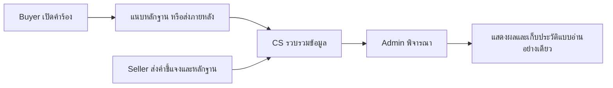

# Customer dispute UI — 11 ตุลาคม 2026

## สิ่งที่ตรวจพบก่อนแก้

หน้า `/support/cases/:orderId` เดิมเปิดดูข้อมูลได้ แต่ไม่เพิ่มหลักฐาน ไม่มีคำแนะนำตามสถานะ
ไม่แสดงบริบทคำสั่งซื้อ และใช้ปุ่ม claim/verdict ของ staff ที่ไม่ตรง workflow ปัจจุบัน
ฟอร์มเปิดคำร้องมีสองชุด และเมื่อ upload ล้มเหลวหลังเปิดเรื่องแล้ว การลองใหม่เรียกเปิดเรื่องซ้ำ
คำสั่งซื้อที่ตัดสินให้ผู้ขายแล้วกลับเป็น completed ยังแสดงปุ่มเปิดข้อพิพาทซ้ำ

## Flow หลังแก้



- แสดงสินค้า ยอดคำสั่งซื้อ ประเภทปัญหา ขั้นตอน ความคืบหน้า และผลพิจารณาเป็นภาษาไทย
- เปิดห้อง CS อัตโนมัติ แยก Buyer/Seller ตาม ownership ของ order ไม่ใช้ role เพียงอย่างเดียว
- ส่งข้อความและไฟล์ใน chat ได้; ใช้ `hideInternal` และสิทธิ์จาก server
- หลักฐานแยกผู้ซื้อ/ผู้ขาย เปิด preview และดาวน์โหลดผ่าน authenticated blob พร้อมคืน object URLs
- เพิ่มหลักฐานภายหลังและ retry เฉพาะไฟล์ที่ยังไม่สำเร็จ ตรวจ MIME/20 MB/ไม่เกิน 5 ไฟล์จาก config เดียวกับ server
- แสดง evidence deadline ที่เจ้าหน้าที่กำหนดจริง ไม่สร้าง deadline จาก case SLA
- หลัง DECIDED แสดงผลและเหตุผล ปิด upload/composer แต่เปิดอ่านประวัติและหลักฐานได้
- ฟอร์มเปิดเรื่องใช้ชุดเดียว มีประเภทปัญหาให้เลือก และคง case ที่สร้างแล้วหากบางไฟล์ล้มเหลว
- Orders/Profile เชื่อมกลับคำร้องเดิม และไม่เปิดคำร้องซ้ำสำหรับ completed order ที่มี dispute แล้ว
- Staff ใช้ workspace ตามสิทธิ์เดิม; ไม่เปลี่ยน schema หรืออำนาจตัดสินเงิน

## Validation

| การตรวจ                                                                                                                                | ผล                         |
| -------------------------------------------------------------------------------------------------------------------------------------- | -------------------------- |
| Tests เฉพาะ feature: ownership, role SELLER ที่ซื้อสินค้า, permissions, DECIDED, MIME/size/count, partial upload retry, duplicate case | 12 tests ผ่าน              |
| Frontend regression สุดท้าย                                                                                                            | 93 suites / 501 tests ผ่าน |
| Production build ของ source สุดท้าย                                                                                                    | ผ่าน                       |
| API flow จริง: Buyer/Seller ส่งหลักฐานและคุย CS, cross-side access 403, outsider 403, private file guest 401                           | ผ่าน                       |
| Browser Buyer: ส่งไฟล์เพิ่ม, ส่งข้อความ, preview หลักฐาน                                                                               | ผ่าน                       |
| Browser Seller: ห้องของร้านค้าแยกจาก Buyer, หลักฐานสองฝ่าย, ส่งคำชี้แจง                                                                | ผ่าน                       |
| Browser closed case: ผลคืนเงินและข้อความอ่านอย่างเดียว ไม่มี upload                                                                    | ผ่าน                       |
| Mobile viewport 390 px: content width ไม่เกิน viewport                                                                                 | ผ่าน                       |
| ความสัมพันธ์ของฐานข้อมูลครบทุก active service หลัง QA                                                                                  | ผ่าน                       |

ฐาน demo มีการใช้งานเพิ่มได้ จึงปรับ verifier ให้ยอมรับคำร้องที่ยังไม่มีไฟล์
แต่ยังตรวจว่า uploads ที่บันทึกใน seed checkpoint มีอยู่จริง และตรวจ ownership/hold/payment
งบ campaign อาจเพิ่มจาก checkout อื่น จึงตรวจ seed attribution เดิมและขอบเขตงบ ไม่บังคับยอดรวมให้คงที่
ไม่มีการ reset ข้อมูลหรือเติมประวัติสมมติให้คำร้องที่ยังรอข้อมูล

## รันตรวจซ้ำ

```powershell
npm run smoke:customer-dispute
npm run seed:local:verify
npm --workspace frontend run build
```

Smoke ใช้ฐาน local demo ตาม guard ของ seeder และ checkpoint ของเคส QA แยก
ผล API/IDs อยู่ใน `tmp/local-dataset-20261011/customer-dispute-smoke.json`
ภาพหน้าจอ Buyer desktop/mobile และ Seller desktop อยู่ในโฟลเดอร์เดียวกัน
บัญชีทดสอบยังเป็นบัญชี demo เดิม; browser คืนเป็น Buyer หลังตรวจ Seller
