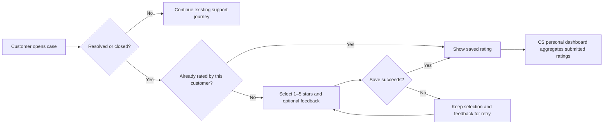

# CSAT — 16 October 2026

## Dashboard design refinement

### Latest — fits desktop, automatic refresh

Removed the manual refresh button and its reserved column. The upper summary cards keep their existing layout and dimensions. Chart rows fill the remaining workspace height, with 44 px priority rows and a single-line CSAT header. Verified `scrollHeight === clientHeight` at 1280×720, 1366×768 and 1440×900. Current screenshots: `ui-verification/dashboard-auto-fit-*`.

The dashboard refreshes both service snapshots on `conversation:activity`, socket reconnect, window focus and tab visibility, plus a 15-second fallback interval for status/CSAT changes without socket notifications. Hidden tabs skip background updates; overlapping requests are guarded and subscriptions/timers are cleaned up. This is event-driven for chat plus polling for other updates, not a claim of server-pushed CSAT/status events. 25 dashboard/CSAT tests passed, including automatic refresh, socket reconnect and stale-data recovery.

### Previous layout — viewport fitting reverted at user request

Restored the version after expanding the priority card: wide trend on the left, stacked priority/CSAT on the right, priority card at least 260 px high with 44 px rows and a donut up to 160 px. Removed only the subsequent viewport-budget and compact summary-metric overrides. The no-scroll experiment below is historical and no longer active.

### Fit the desktop viewport (reverted)

This experiment used the available workspace height with flexible chart rows and compact horizontal summary metrics. The recorded checks and screenshots (`ui-verification/dashboard-fit-*`) apply only to that reverted version.

### Trend chart space correction

The desktop overview now gives the trend about two thirds of the available width, with compact priority and CSAT summaries stacked in the right column. A short-screen variant keeps the date axis visible at 1280×720. Date ticks use the measured SVG width and reserve at least 70 px between labels, including the last date, while retaining every data point and hover target. Verified 14/30-day axes, 1440×900, 1280×720 and mobile; 29 chart/dashboard/CSAT tests pass. Latest screenshots: `ui-verification/dashboard-wide-trend-*`.

CSAT now follows the existing dashboard entrance state: the arc draws and the needle sweeps for 1,250 ms with the same 80 ms delay/easing as the priority chart, while the percentage uses the shared 1,100 ms counter. Authentication transitions pause the entrance, and refresh/date changes do not replay it. Reduced-motion settings disable CSAT animations and show the final percentage immediately.

The CSAT card now shares the dashboard's actual widget/header classes, including responsive padding, typography, border and shadow. Its title aligns with the priority card; both analytic cards have equal desktop widths. The gauge occupies a dedicated chart area, with satisfaction count and star average in separated statistic rows and Ticket/Dispute counts in a compact footer. This replaces the previous vertically centered block of text. Verified at 1440×900, 1280×720 and 390×844 with no horizontal overflow; 21 gauge/dashboard tests and ESLint pass. Current screenshots: `ui-verification/csat-dashboard-redesign-*`.

## System review and implementation plan

Reviewed the existing Ticket lifecycle, requester/agent access, assignments, SLA rounds, chat integration, retention, dispute buyer/seller ownership, assignment audit envelopes, Admin/Trust & Safety handoff, and personal dashboard aggregation before implementing.

- Ticket source: `support-service/src/features/tickets/{ticketService,ticketModel,ticketShape,ticketState}.js`. Customers share `/support/tickets/[id]`; resource ownership determines who may rate.
- Dispute source: `order-service/src/features/disputes/{disputeService,disputeModel}.js`. `/support/cases/[orderId]` serves buyer/seller independently. `DECIDED` is terminal; CS may hand off before another authority records the verdict.
- Staff source: `AgentDashboard.js`, **AgentOverview.module.css**, and each service's `agentDashboard.js`. Both APIs contribute to one personal CS overview, with Bangkok calendar-day filters.

Plan implemented: service-owned persistence → shared validation/authorization and submission → reusable customer rating card in both journeys → weighted dashboard gauge → automated and live UI verification.

## Behavior and decisions

- Ticket: requester may rate at `RESOLVED` or `CLOSED`, whether their account is buyer or seller. A visible open ticket refreshes every 15 seconds so the survey appears after an agent resolves it.
- Dispute: actual order buyer and seller each have one independent response after `DECIDED`, regardless of account role or verdict outcome. Existing dispute refresh picks up the terminal state.
- Stars are required integers 1–5. Feedback is optional and limited to 1,000 characters. Customers see their own saved feedback. Staff and unrelated customers cannot submit on someone else's behalf.
- One immutable response per case/customer, including a ticket that is later reopened. Same-payload retries return the saved response; different-payload repeats return 409. This intentionally measures one overall case experience rather than a separate score per SLA cycle.
- Case row locks serialize submissions and status changes; a composite primary key independently prevents duplicate votes. Both databases have additive migrations, a case foreign key, star/comment checks, and an agent/time index.
- Agent attribution is captured on submission. Tickets prefer the persisted CS chat responder, with historical assignment fallback. Disputes use the latest CS assignment at/before the verdict, decoding historical role envelopes; a later Admin verdict does not steal CS attribution. Ratings without any attributable agent remain saved but are absent from a personal dashboard.
- CSAT = number of 4–5-star responses / all submitted responses × 100, rounded to a whole percent. The gauge combines raw counts across services, **not** an average of their percentages. It also shows the star average, sample size and per-source response counts. Both buyer/seller dispute responses count as responses.
- Date filtering uses **submission time**, Bangkok calendar days, and the existing today/7/14/30-day control. No responses show a dash and an explicit empty state; no fabricated 0% or 84%.

## Contracts and storage

Authenticated `GET`/`POST` endpoints:

| Resource | Endpoint                        | Eligibility                 |
| -------- | ------------------------------- | --------------------------- |
| Ticket   | `/api/support/tickets/:id/csat` | Requester, resolved/closed  |
| Dispute  | `/api/orders/disputes/:id/csat` | Order buyer/seller, decided |

POST body: `{ "rating": 5, "comment": "optional feedback" }`.
Response: `{ "eligible": false, "complete": true, "response": { "rating": 5, "comment": "...", "createdAt": "..." } }`.
GET returns `response: null` before submission. Each existing agent dashboard adds `csat: { total, satisfied, scoreSum, percent, average, distribution }` scoped to the authenticated CS agent.

Both services own a `customer_satisfaction` table and Prisma model. Migration: `20261019000000_customer_satisfaction`. Standard `node prisma/migrate.js` deployment applies it. Local migrations and runtime updates were performed without resets or volume deletion.

## Verification

- Backend: 21 targeted tests passed, including shared CSAT validation, access, idempotency, privacy, calculation and existing lifecycle regressions.
- Frontend: 30 tests passed across rating card, weighted gauge, customer dispute page, and dashboard. Empty/error/retry/read-only states are covered.
- ESLint passed for changed JavaScript. Prisma clients generated successfully in both service builds.
- `node scripts/verify-csat.cjs` passed against real local APIs/PostgreSQL: both ticket roles, open-state rejection, unrelated-user/staff rejection, invalid stars, simultaneous identical submissions, immutable duplicates, independent dispute sides, persisted scores, and dashboard attribution after Admin handoff.
- Browser: submitted ratings through all four customer flows (buyer/seller × ticket/dispute); saved confirmation was visible. Screenshots live beside this document under `ui-verification/csat-*`.
- Responsive dashboard verified at 1440×900, 1280×720 and 390×844; no horizontal overflow. The mobile gauge remains readable after scrolling to the card. Customer dispute controls were also verified at 390×844.
- After recreating both service containers, `node scripts/verify-csat.cjs --read-only` passed: all saved ratings remain readable, and each service reports 3/4 satisfied responses (combined 75% from 8 local QA responses). Both updated services are healthy.

The acceptance script adds clearly labelled `[CSAT QA]` cases and keeps their links in `ui-verification/csat-qa-manifest.json`. Synthetic dispute fixtures exercise the CSAT boundary without payments or inventory operations. Existing customer cases are not modified. These QA ratings are real rows and are included in the local demo dashboard.

Run `npm run smoke:csat` to add and verify a fresh fixture set. Run `npm run smoke:csat -- --read-only` to recheck the recorded set without adding more cases. Demo accounts must be present; credentials and database URLs are read from the existing local configuration and never written to the manifest.
